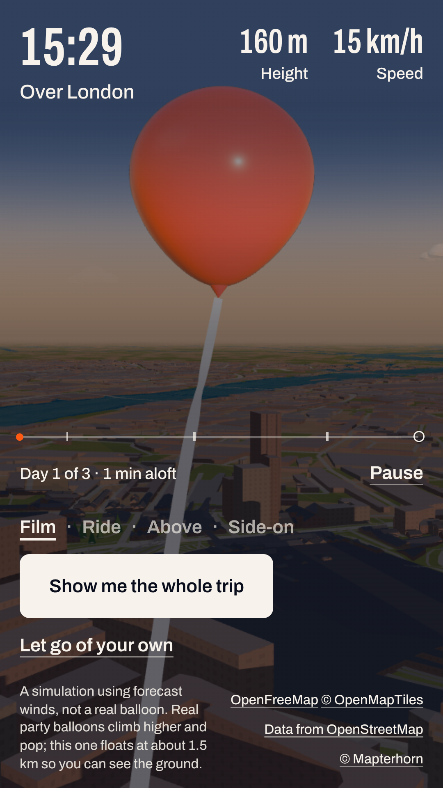
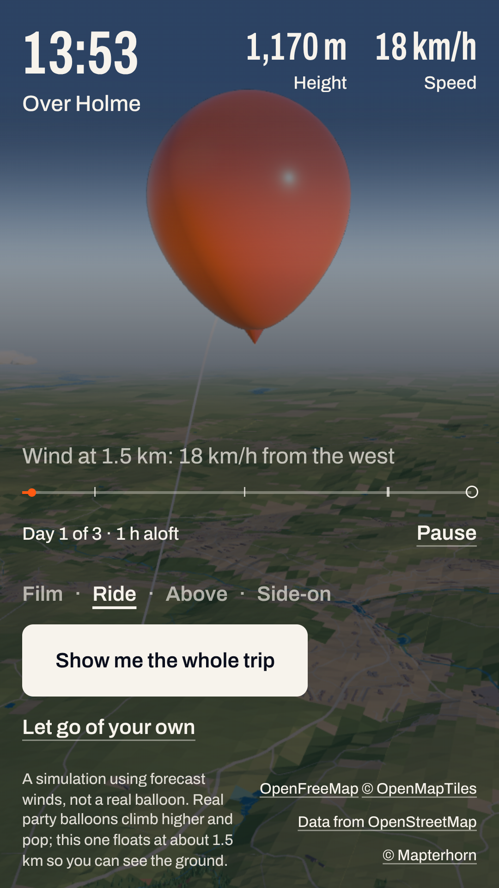

# Let go of a balloon: hand-back

Everything you need to post it.

> **Draft.** Two things are still to come: the live link (once you say yes to going live, see `go-live.md`), and the landing card, which is being redesigned. Both are marked **To come** below.

## The live link

**To come:** https://let-go-of-a-balloon.pages.dev

That is the address the site will have once it goes live. Until then, the preview is https://claude-new-session-31f9yr.let-go-of-a-balloon.pages.dev

Before you post, do the 5-minute phone test in `phone-test.md` on the live link.

## Screenshots

Each picture is 1080 x 1920, the size of a phone screenshot. They are in the `img` folder next to this file.

### London, the launch at golden hour

A balloon let go from Parliament Square a minute earlier, now 160 m up over Westminster at 15:29, with the Thames and the low November sun behind.



This is a minute after the hand opens, not the moment itself. The test machine was too busy to catch the moment the person lets go: one try timed out, and the one frame it did catch had a flat grey band across the top half of the picture. That may only be the test machine, but please look out for it in the phone test (step 1). For the post, the best launch picture will be a screenshot from your own phone, taken while the balloon rises past Big Ben.

### The Ride view over the moors

A balloon from Manchester, about 90 minutes after it was let go, at about 1,200 m over Holme, on the edge of the Pennine moors below Holme Moss. The fact line reads "Wind at 1.5 km: 18 km/h from the west".



### The landing card

**To come**, when the new card design is in.

<!-- img/landing-card.png: the 1080 x 1350 card for a London balloon, shown full screen on a 1080 x 1920 phone -->

### How these were made

They come from the automatic browser tests: a 360 x 640 phone screen at 3 times the detail, so 1080 x 1920. The winds are a real forecast saved for the tests, and the streets and hills are the real map. Both balloons are opened from a link, as if someone had shared them. To make them again:

```
HANDBACK_SHOTS=docs/for-sk/img CI=1 E2E_PORT=5190 npx playwright test e2e/handback-shots.spec.ts --workers=1 --trace off
```

Your own phone will look sharper and smoother than these. The test machine has no graphics chip.

## A 15-second recording, shot by shot

Silent, upright, made for the LinkedIn and X phone apps. It needs no sound: everything reads from the picture.

### Get ready

- Record at **golden hour in London**: in November and December, between about **3:15 and 3:50 pm**. The site shows the real time of day where the balloon is, so this is when the light is warm and the shadows are long.
- Turn on **Do Not Disturb**, so no messages slide in over the recording.
- Use the normal address, without `?fps=1`, so the frame counter is not in the shot.
- Turn the phone's brightness up.
- **iPhone:** open Control Centre (swipe down from the top-right corner) and tap the **Screen Recording** button (a dot inside a circle). If it is not there, add it in **Settings**, **Control Centre**.
- **Android:** swipe down twice from the top and tap **Screen recorder**. On some phones it is called **Screen record**.

You will record two or three short clips and join them. It is easier than getting it all in one take.

### The shots

| Time | Shot | What to do |
| --- | --- | --- |
| 0 to 2 s | **Let go.** The start screen in London. The person holds the red balloon in the street, with Big Ben behind. | Start recording on the start screen. Wait one second, then tap **Let go**. |
| 2 to 6 s | **Rise past Big Ben.** The buttons fade, the hand opens, and the balloon floats up past the windows and roofs, with Big Ben beside it. | Do nothing. Let it play. |
| 6 to 9 s | **Ride view.** The camera hangs just behind the balloon, high over the city or the country. | The balloon takes about 20 minutes to climb to cruising height. Let go, then come back 20 minutes later: tap the balloon under **Your balloons** on the start screen. Then tap **Ride** and record 5 seconds. |
| 9 to 13 s | **The whole trip.** A high, wide view. The trail sweeps across countries, with place names as it passes them. | Tap **Show me the whole trip** and record all of it (about 20 seconds). You will cut it down to its best 4 seconds. |
| 13 to 15 s | **The card.** The postcard: where it is expected to land, how far, and how fast. | **To come**, with the new card. It appears by itself at the end of the whole trip. |

### Join the clips

- **iPhone:** open the free **iMovie** app. Tap **Start New Project**, then **Movie**. Choose the clips in order and tap **Create Movie**. Tap a clip to trim its ends. To speed up the whole-trip clip, tap it, tap the speed button (a clock dial), and drag it to **4x**. Then tap **Done**, the share button, and **Save Video**.
- **Android:** open **Google Photos**. Tap **Create** (or the **+**), then **Movie**. Choose the clips in order. Drag the ends of each clip to trim them, then tap **Save**.

Keep the finished video under 20 seconds.

## Three ideas for the post

Each one starts with the hook: the line people see before they tap **...more**. Fill in the blank with where your balloon is expected to land.

1. **The personal one** (the brief's angle)
   > I let go of a balloon in Westminster this afternoon. Today's real winds say it will come down near ___ on Sunday.
   >
   > Let go of your own, from your town: [link]

2. **The question**
   > Where would a balloon from your town end up?
   >
   > I built a page that lets one go on today's real forecast winds and follows it for three days, over a small hand-made copy of the real world. Mine is heading for ___.

3. **The builder post**
   > Built with AI over a few days, and it costs nothing to run: let go of a balloon from any town on Earth and follow it on today's real winds for three days.
   >
   > Mine left London. It is expected to land near ___.

Say clearly, somewhere in the post, that it is a simulation using forecast winds, not a real balloon. The site says so too.

## Optional: your own web address

At the moment the address is `let-go-of-a-balloon.pages.dev`. It is free and it works well. If you would like a shorter address of your own, such as `letgoofaballoon.com`, it costs about **£10 to £15 a year**. That is the only cost. You pay Cloudflare once a year, by card.

You do not need one. Say if you want it.

### Buy the address

1. Go to https://dash.cloudflare.com and sign in.
2. In the left-hand menu, click **Domain Registration**, then **Register Domains**.
3. In the search box, type the address you would like, for example `letgoofaballoon`, and click **Search**.
4. Cloudflare lists the endings that are free to buy (`.com`, `.co.uk` and so on), with the price for one year. Pick one and click **Purchase**.
5. Fill in your contact details. Domain rules require them. Cloudflare hides them from the public.
6. Leave **Auto renew** on, so the address does not run out.
7. Add your card and click **Complete purchase**.

### Point it at the site

1. In the left-hand menu, click **Workers & Pages**.
2. Click **let-go-of-a-balloon**.
3. Click the **Custom domains** tab.
4. Click **Set up a custom domain**.
5. Type the address you bought, for example `letgoofaballoon.com`, and click **Continue**.
6. Click **Activate domain**.

Because you bought the address from Cloudflare, it sets everything else up by itself. It usually works within a few minutes, and always within a day. The old `pages.dev` address keeps working as well.

### Then tell me

Tell me in chat which address you bought. I will change the address printed on the landing card and in the link preview that LinkedIn and X show, and check that the site works on the new address. You never need to send me a password or a code for any of this.
